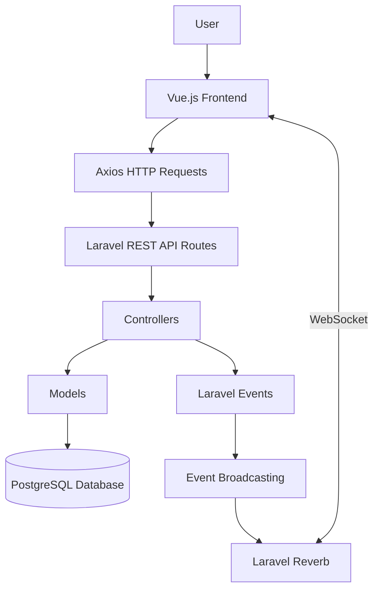

<<<<<<< HEAD
# E-Shopping-Abalo
=======
# E-Shopping-Abalo 🛒

**A Full-Stack E-Commerce Web Application**

E-Shopping-Abalo is a full-stack web application designed to provide users with a modern online shopping experience. It offers an interactive platform where users can browse products, search for items, manage their shopping carts, and access their personal accounts.

The application combines Laravel and Vue.js to deliver a responsive user experience, REST API communication, database-backed functionality, and real-time notifications.

## ✨ Key Features

- **User Authentication:** User registration and login.
- **Database-Backed Shopping Cart:** Add, remove, and manage products with cart data stored in the database.
- **Product Management:** Create and add new products to the shopping platform.
- **Product Search:** Search for available products.
- **Cookie Management:** Handle cookie-related functionality.
- **Real-Time Notifications:** WebSocket-based communication using Laravel Reverb.
- **RESTful API:** Backend functionality exposed through Laravel API routes.

## 🛠️ Tech Stack

| Technology | Purpose |
|---|---|
| PHP | Server-side programming |
| Laravel 12 | Backend framework |
| Vue.js 3 | Frontend framework |
| JavaScript | Client-side functionality |
| Node.js & npm | Frontend tooling and dependency management |
| Axios | HTTP requests and API communication |
| PostgreSQL | Relational database |
| Laravel Reverb | WebSocket server for real-time communication |
| Laravel Echo | Client-side event broadcasting |
| Git | Version control |

## 🏗️ Architecture

The application follows the **Model-View-Controller (MVC)** architectural pattern, separating application logic, data management, and presentation.

### Backend – Laravel

- Handles application logic, routing, authentication, and database operations.
- Uses Laravel controllers to process incoming API requests.
- Uses models to interact with PostgreSQL.
- Provides REST API endpoints through Laravel API routes.
- Implements event broadcasting for real-time notifications using Laravel Reverb.

### Frontend – Vue.js

- Provides a component-based user interface.
- Uses Axios to communicate with Laravel REST API endpoints.
- Handles user interactions, product searches, and shopping cart functionality.
- Receives real-time events through WebSocket communication.

### Database – PostgreSQL

PostgreSQL is used for persistent data storage, including user accounts, product information, and shopping cart data.

### Real-Time Communication – Laravel Reverb

Laravel Reverb enables WebSocket-based communication between the backend and frontend.

When relevant events are broadcast by the backend, connected clients can receive updates without repeatedly polling the server.

### Architecture Overview

## 🛒 Shopping Cart Implementation

The shopping cart uses database-backed storage to persist shopping cart information.

Unlike a purely client-side shopping cart, this approach allows cart data to be stored and retrieved through the backend.

This provides practical experience with:

- Database-driven e-commerce functionality.
- Backend and frontend integration.
- Persistent shopping cart management.
- REST API communication.
- Product and cart data management.

## 👨‍💻 My Contribution

I was responsible for the development and implementation of E-Shopping-Abalo, working on both frontend and backend components. The real-time notification system using Laravel Reverb was not part of my responsibilities.

My responsibilities included:

- Developing the application using Laravel and Vue.js.
- Designing and implementing REST API endpoints.
- Structuring backend functionality using the MVC pattern.
- Implementing user registration and authentication.
- Developing database-backed shopping cart functionality.
- Implementing product creation and search features.
- Integrating PostgreSQL for persistent data storage.
- Connecting frontend and backend functionality using Axios.

## 💡 Skills & Experience Gained

Through this project, I gained practical experience in:

- Full-stack e-commerce application development.
- REST API design and integration.
- MVC architecture and backend organization.
- Relational database integration with PostgreSQL.
- Persistent shopping cart implementation.
- Product management and search functionality.
- Frontend and backend integration.
- Working with modern JavaScript frameworks.

## 🔗 Repository

[GitHub – E-Shopping-Abalo](https://github.com/duyhuynh5655fh-dev/E-Shopping-Abalo)

## 👤
>>>>>>> c3eacc2 (add README.md)
